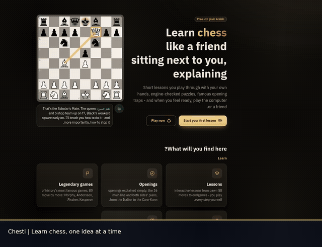

# Chesti | Think. Play. Conquer.

[Open the live site](https://chesti.pages.dev/)

A chess learning and practice site with plain-language explanations, interactive boards and short training sessions. The interface supports Arabic and English.

## Live walkthrough



[Watch or download the MP4 recording](docs/demo/walkthrough.mp4). Two-voice Egyptian-Arabic narrated walkthrough, recorded from the live site on November 15, 2026; the interface may change as development continues.

## Features

- Play-through lessons, opening explanations, traps and annotated miniature games.
- Tactical puzzles, a daily puzzle, puzzle rush, square training and an endgame lab.
- Computer and local play, game review screens and a 3D chess world.
- Account/profile screens and progress tools backed by the separate Hono API. Guest learning remains available.

## Stack

Next.js App Router, React, TypeScript, Tailwind CSS, chess.js, react-chessboard and Three.js. The frontend exports static HTML to Cloudflare Pages. `backend/` contains the Cloudflare Workers + Hono + D1 API.

## Run locally

Use a current Node.js LTS release compatible with the versions in `package.json`.

```bash
npm install
npm run dev       # http://localhost:3000
npm run typecheck
npm test
npm run build     # static export in out/
```

See `.env.example` for frontend configuration. Account and sync features require a configured API; do not put server secrets in `NEXT_PUBLIC_*` variables.

## Backend

The API has its own dependencies, migrations and local D1 database:

```bash
cd backend
npm install --legacy-peer-deps
npm run db:migrate:local
npm run dev
```

See [API documentation](backend/README.md) and the [Arabic setup guide](backend/SETUP.ar.md). Local commands do not migrate a remote database. Back up a deployed database and review migrations before applying them remotely.

## Repository map

- `src/app/`: routes and metadata.
- `src/components/`: boards, navigation and training UI.
- `src/data/`: lessons and chess content.
- `src/lib/`: application and chess helpers.
- `backend/`: API, migrations and backend checks.
