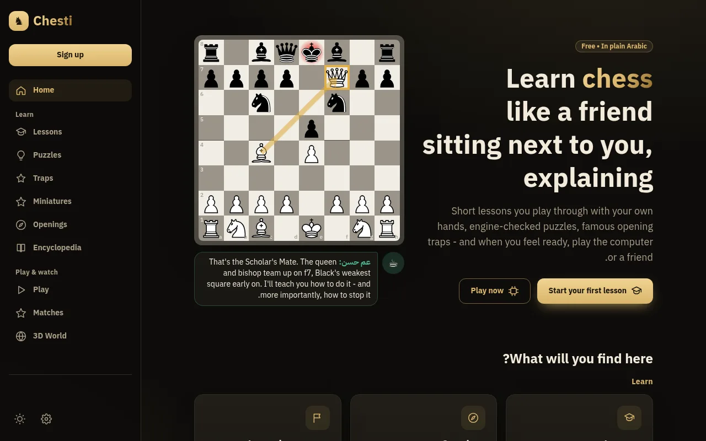

<div align="center">

# Chesti · Think, Play, Conquer

### Learn chess like a friend sitting next to you, explaining

Short lessons you play through with your own hands, engine-checked puzzles, famous
opening traps — and when you feel ready, play the computer or a friend. Free, in plain Arabic.

[](https://chesti.pages.dev)
[](https://nextjs.org)
[](https://threejs.org)
[](https://pages.cloudflare.com)

[](https://chesti.pages.dev)

**[Start your first lesson →](https://chesti.pages.dev)**

</div>

---

## What you'll find here

- **Lessons** — interactive, hands-on: every idea is played out on the board, move by move, with plain-Arabic explanations.
- **Puzzles** — engine-checked tactics with clear feedback.
- **Traps** — the famous opening traps, how to set them and how to stop them.
- **Miniatures** — short master games, annotated.
- **Openings** — a guided openings library.
- **Encyclopedia** — terms, ideas and patterns in one place.
- **Play** — against the computer at your level, or a friend.
- **Matches** — your saved games and history.
- **3D World** — a WebGL chess world built with Three.js.
- **Glossary, daily content, endgames, rush mode** — and an Arabic-first UI (RTL) with full English support.

## Architecture

```
Next.js (TypeScript) frontend on Cloudflare Pages
  ├─ chess.js rules engine + react-chessboard boards
  ├─ Three.js 3D world
  └─ /api ──► Cloudflare Workers + D1 backend (backend/, Hono + TypeScript)
        ├─ Accounts: PBKDF2-SHA256 (100k iterations), per-user salt
        ├─ Sessions: 32-byte tokens, only SHA-256 stored, 30-day validity
        ├─ Saved games, progress sync, public leaderboard
        └─ CORS restricted to ALLOWED_ORIGINS
```

The backend's own README covers the local setup, seed data, the full API table and the
deploy steps (`backend/README.md`, `backend/SETUP.ar.md`).

## Develop

```bash
npm install
npm run dev        # frontend
npm run build

cd backend
npm install --legacy-peer-deps
npm run db:migrate:local
npm run dev        # http://localhost:8787/api/ping
npm test           # 22 tests on a local D1
```

---

<div align="center">

Made with care by **Mohamed Alhinawi** · [chesti.pages.dev](https://chesti.pages.dev)

</div>
